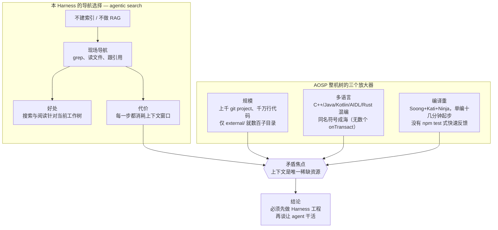
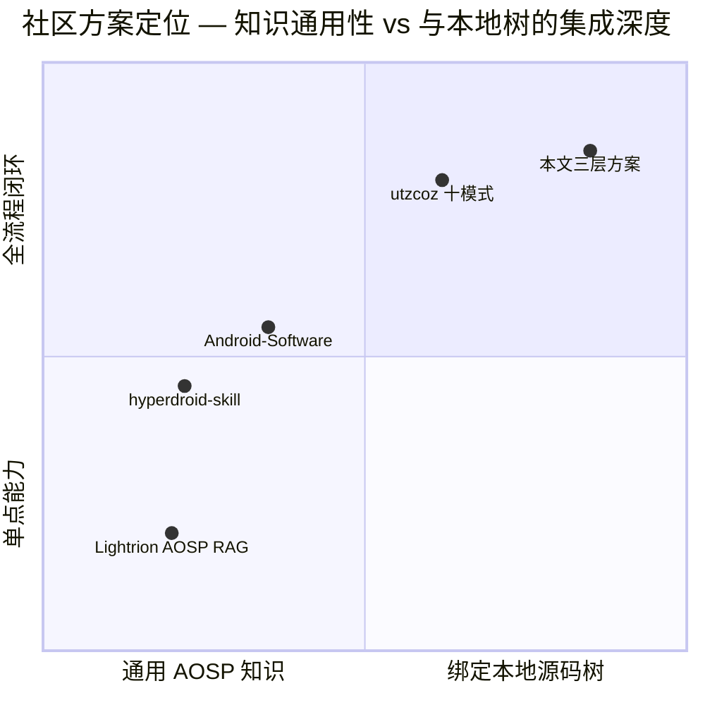
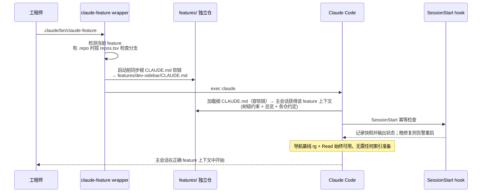
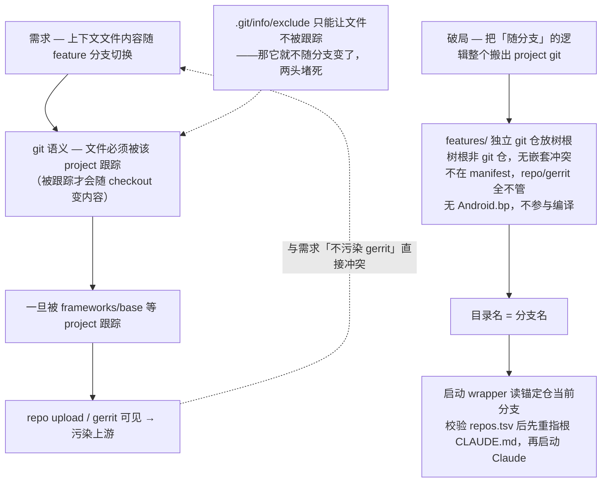
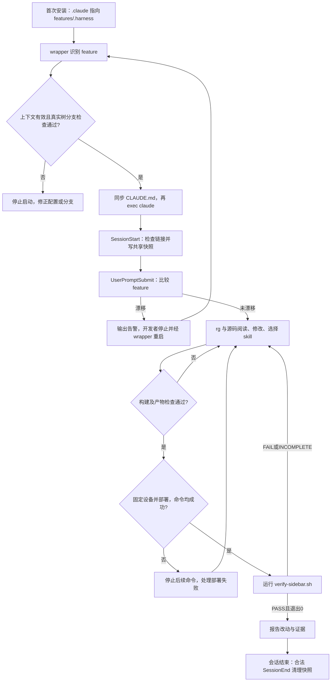
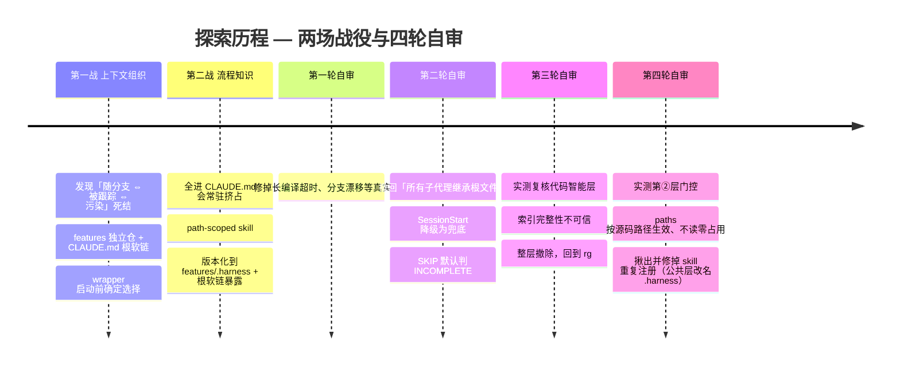

# AOSP 整机源码 Harness 工程探索（Claude Code 版）

> 本文说明 Claude Code 版 AOSP Harness 的上下文选择、构建部署流程和功能验收。实现位于仓库的 [claude-code/](../claude-code/README.md)，示例目标为 AOSP 17、Cuttlefish 和 `dev-sidebar`。当前仓库仅包含占位源码；离线测试证明脚本行为，不代表系统已编译或功能已通过真机验证。

实现说明以本地 wrapper、hooks、skills 和验证脚本为依据。前面的外部方案介绍与早期整机观察用于说明设计背景；客户端版本相关行为仍需在实际部署环境核对。

---

## 一、问题：为什么 coding agent 在整机源码树上"开箱不可用"

这套 Harness 采用 **agentic search** 现场导航，不配置代码索引或 RAG——grep、读文件、跟引用，像一个新来的工程师翻代码。这个设计有一个巨大的好处和一个巨大的代价：

- **好处：直接读取当前工作树。** 搜索与阅读针对当前 checkout，不会像向量索引那样"返回两周前已改名的函数、或引用一个已删除的模块，却不告诉你它过期了"。
- **代价：上下文窗口是唯一稀缺资源。** 导航的每一步（grep 结果、读过的文件）都在消耗上下文；导航质量完全取决于你把代码库"布置"得多好。

AOSP 整机源码树把这个矛盾推到极端，有三个放大器：



不搭 harness，直接在整机树上用 coding agent 会反复撞上这些墙（以下沿用早期整机探索记录，当前占位 demo 不复现这些整机现象）：

| 痛点 | 现象 |
| --- | --- |
| 导航失效 | 全树 grep 一次就吞光上下文；文本匹配跳到错误的同名符号 |
| 上下文盲区 | 每个新会话都不知道"当前在做哪个 feature、哪些仓能动、有哪些硬约束" |
| 流程知识丢失 | 每次都要重新教它怎么编译、产物在哪、push 哪些文件 |
| "编过 = 改对"幻觉 | 编译成功就认为功能正确，会话心满意足地结束，设备一跑就崩 |
| 知识污染 | 上下文文档混进 gerrit project 的提交 |
| 隐性经验反复付学费 | "改了这个类布局必须连某个 so 一起重编"这类血泪知识，不固化下来每次重新踩 |

**核心论断：模型不是瓶颈，环境才是。** 社区先行者 utzcoz 用 Claude Code 做成 4 个 AOSP 级项目后的结论也是如此：这类工作 coding agent 开箱做不好，能做成靠的是围绕 agent 搭的 **harness engineering**——"harness 诚实，产出就诚实"。

---

## 二、官方参照：Anthropic《How Claude Code works in large codebases》的要点

上一节的困境不是 AOSP 独有的。Anthropic 官方博客《How Claude Code works in large codebases》归纳了 Claude Code 在大型代码库（百万行 monorepo、几十年遗留系统、几十个仓的分布式架构）落地成功的共性模式——它不是为 AOSP 写的，但几乎每一条都能对上整机树的处境，是我们方案的通用理论底座。这里先把它的要点提炼出来；后文第四节起的三层，本质就是把这些通用原则一条条落到整机树上的具体形态。

### 2.1 Claude Code 怎么在大库里导航：agentic search，而非 RAG

博客把第一节我们已经点到的机制说得更透：

- **agentic search**：像工程师一样遍历文件系统、读文件、用 grep 精确定位、跟着引用跨库跳转；**本地运行、不需要建立/维护/上传任何索引**。
- **RAG 在大规模下会失效**：embedding 管线追不上活跃的工程团队——开发者查询时，索引反映的是几周/几天/几小时前的代码，于是**返回一个两周前已改名的函数、或引用一个上个 sprint 已删除的模块，却完全不提示它已过期**。
- **代价与甜区**：agentic search 反过来要求**足够的起始上下文**才知道去哪找；导航质量取决于代码库被"布置"得多好（用 CLAUDE.md + skills 分层）。若向一个十亿行的库问一个模糊 pattern，会在开工前就撞上上下文窗口墙。**在代码库布置上投入的团队，效果明显更好。**

### 2.2 harness 与模型同等重要：五个扩展点 + 两项能力

博客点名一个最常见的误解——以为 Claude Code 的能力只由所用模型决定。实际上**围绕模型的生态（harness）比模型本身更决定表现**。harness 由五个扩展点构成，外加两项能力，且**叠加有顺序——每一层都建立在前一层之上**：

| 组件 | 是什么 | 何时加载 | 最适合 | 常见误用 |
| --- | --- | --- | --- | --- |
| **CLAUDE.md** | 自动读取的上下文文件 | 每个会话 | 项目约定、代码库知识（根=全局、子目录=局部） | 把该进 skill 的可复用经验塞进来 |
| **hooks** | 关键时刻运行的脚本 | 事件触发 | 自动化一致行为、**捕获会话经验（自我改进）** | 用 prompt 去做本应自动跑的事 |
| **skills** | 针对特定任务打包的指令 | 按需、相关时 | 跨会话/项目的可复用专长（渐进式披露、可按 path scope） | 全塞进 CLAUDE.md |
| **plugins** | 打包 skills/hooks/MCP | 配好后常驻可用 | 把一套可用配置分发到全组织 | 让好做法停留在部落知识 |
| **MCP servers** | 连接外部工具与数据 | 配好后常驻可用 | 让 Claude 够到本来够不到的内部工具 | 基础没跑通就先建 MCP |
| **LSP**（能力，非扩展点） | 语言服务器提供的符号级导航 | 配好后常驻可用 | 精确的定义/引用跳转，比文本搜索省上下文 | 在索引建不完的规模上信任它的完整性（本文第四节末「不采纳一」即栽在这里） |
| **subagents**（能力，非扩展点） | 独立上下文的隔离实例 | 被调用时 | **把探索与编辑分离**、并行 | 在同一会话里既探索又编辑 |

其中几条博客特别强调的：**hooks 最有价值的用法不是防错，而是让配置自我改进**（stop hook 会话末反思→提议改 CLAUDE.md）；**skills 可 path-scoped**，只在相关目录激活；**subagents 的典型用法是只读子代理测绘子系统、主代理再带全貌编辑**。这里必须补一个当前 Claude Code 的行为边界：大多数自定义子代理启动时会加载 memory hierarchy，但它们仍是隔离上下文；内建 **Explore/Plan 明确跳过 `CLAUDE.md` 与 git status**。所以不能把“所有子代理继承根 `CLAUDE.md`”当成契约，更不应该给每个子代理复制整份 feature 文件；派发 prompt 才是稳定接口，应只放目标、范围、会改变结论的关键事实、约束和输出格式。

### 2.3 三个配置模式

博客从成功部署里提炼出三个反复出现的模式：

1. **让大库对 Claude 可读**：CLAUDE.md 精简且分层（根只放指针 + 关键坑）；**在子目录而非仓根初始化**（Claude 会自动向上加载沿途每个 CLAUDE.md，根上下文不丢）；按子目录 scope test/lint 命令（跑全套会超时、烧上下文）；用 `.ignore` / 版本化的 `permissions.deny` 排除生成物、构建产物、三方码；目录结构不给力时写一份轻量 **codebase map**；以 grep/文件阅读建立可工作的导航基线。
2. **随模型演进主动维护 CLAUDE.md**：为旧模型缺陷写的规则会拖累新模型（如"每次重构拆成单文件改动"会阻止新模型做它本已擅长的协调跨文件编辑）；为补模型/工具缺陷写的 skill/hook 一旦缺陷消失就成负担。**每 3–6 个月、或模型换代后感觉见顶时**做一次配置重审。
3. **指派 owner**：技术配置本身不驱动采纳；铺开最快的组织在放开前就有专人/小队把工具接进工作流，出现 **agent manager**（PM/工程混合角色）或至少一个 **DRI**，并尽早对齐治理（谁管 skill/plugin、避免重复造轮子、AI 代码走同样的 review）。

### 2.4 适用边界

博客最后划了适用范围：Claude Code 面向**常规软件工程环境**——工程师是主要贡献者、用 Git、标准目录结构。非常规设置（游戏引擎的大二进制资产、非常规版本控制、非工程师贡献代码）需要额外的配置工作。

> 这些都是通用结论；而整机树把每一条的难度都放大了（第一节的三个放大器）。后文第四节起，就是我们把这套通用原则逐条落到 AOSP 整机树上的具体形态——并在两处（子目录初始化、plugin 分发）因 repo 工程的现实做了有意背离（见第四节末）。

---

## 三、他山之石：网络上已有的类似方案

动手自建之前，我们先调研了社区在"AOSP + coding agent"这个方向上已有的探索（调研时间 2026-07）。有代表性的四个方案，恰好各占一个生态位：

| 方案 | 形态 | 一句话定位 |
| --- | --- | --- |
| [Lightrion AOSP RAG](https://lightrion.com/docs) | 托管 MCP 服务（SaaS） | 对公开 AOSP 各版本做语义检索，agent 即插即查 |
| [utzcoz《Using Claude Code on AOSP-scale projects》](https://utzcoz.github.io/2026/04/26/using-claude-code-on-aosp-scale-projects.html) | 方法论（博客） | 4 个已交付 AOSP 级项目沉淀的 harness engineering 十模式 |
| [hyperb1iss/hyperdroid-skill](https://github.com/hyperb1iss/hyperdroid-skill) | Claude Code 插件 | Android 通用领域技能包（adb/fastboot/构建/LineageOS）+ crash 分析 agent |
| [jonaschen/Android-Software](https://github.com/jonaschen/Android-Software) | 分层 skill 知识包 | L1 路由 → L2 子系统专家，防幻觉路径与跨域错配 |

### Lightrion AOSP RAG：托管的 AOSP 语义检索

一个商业 MCP 服务：把 AOSP 13–17 各发布版预先建好索引，暴露 `search_code` / `get_chunk` / `get_file` / `list_versions` / `diff_versions` 五个工具，任何 MCP 客户端加一个 bearer token 就能用自然语言检索 AOSP 源码，还能按 minor release 钉住版本、跨版本 diff。

- **优点**：零本地成本——不需要本地源码树、不需要自己建索引；多版本覆盖 + 跨版本 diff 是独有能力（"这个函数在 15→17 之间改了什么"一问即得）；接入是标准 MCP，五分钟配完。
- **局限**：它索引的是**公开 AOSP 发布版**，而整机开发的工作对象是**自己的本地树**——你刚改过的代码、本地 feature 分支、树上的任何 delta 它都不知道。这正是 Anthropic 官方博客点名的 RAG 死穴（"返回已改名的函数却不告诉你它过期了"）在 fork 场景下的极端形态。此外代码问题出网查询有保密性顾虑；且它只覆盖"读与查"这一层，编译、部署、验证全不涉及。
- **我们的取舍**：不能作为本地树的主导航——live 树的基线是 `rg` + 直接阅读当前源码。它作为"查上游基线/跨版本差异"的补充通道仍有真实价值。

### utzcoz 十模式：被四个交付项目验证过的方法论

作者用 Claude Code 做成并发布了 4 个 AOSP 级项目（ARM64→x86_64 二进制翻译器、AOSP 14 多窗口补丁集、Chromium WebXR 移植、64 章 AOSP 内核书），沉淀出十条 harness engineering 模式，分三组：跨会话保存状态（CLAUDE.md 行为契约、handoff 交接文档）、验证（模拟器基座、verify 脚本只编码一次、红条 TDD、读截图判对错）、输出可信（结论带源码路径行号、冷启动对抗 review）。

- **优点**：唯一经过"真的交付了东西"检验的完整方法论；对"编过 = 改对"幻觉、"似是而非 ≠ 正确"这两个 agent 根性问题给出了系统解法；多条模式可直接照抄（CLAUDE.md 只写 agent 默认会犯的错、verify 脚本单入口确定性输出）。
- **局限**：它是方法论而非可安装工件，每个项目都要自己重新落地；其项目形态是"单仓 fork + 模拟器"，没有处理 repo 千仓工程特有的问题——上下文文件会污染 gerrit project、上下文如何随 feature 分支切换。
- **我们的取舍**：十模式是本文方案在理念层的最大来源——CLAUDE.md 行为契约、verify 确定性脚本、"harness 诚实产出就诚实"都直接进入了设计；repo 工程特有的部分（第五、六节）则是我们补上的。

### hyperdroid-skill：插件化的 Android 通用技能包

LineageOS 社区开发者的 Claude Code 插件（MIT）：四个按触发词自动激活的 skill（`android` 设备/adb、`android-fastboot` 刷机/分区/防砖、`android-build` Gradle+AOSP 构建、`lineageos` repo/Gerrit 工作流）加一个受限工具的 `crash-analyzer` 子代理（自主收集 logcat/tombstone/ANR 后给诊断）。

- **优点**：**工程骨架是四家里最值得抄的**——单仓分发多 skill + agent（plugin.json/marketplace 一键装）、渐进式披露（SKILL.md 速查 + `references/` 深度页按需加载）、触发词自动激活、受限工具 + 固定工作流的子代理模板、仓库自校验 Makefile（CI 强制每个 skill 结构合规）。
- **局限**：内容是**参考手册级的通用知识**（adb/fastboot/构建命令速查），视角偏三方 ROM 玩机而非整机平台开发；不绑定任何具体源码树——不知道你的 feature、你的编译产物、你的验证脚本；对树内导航、上下文经济、gerrit 污染等核心矛盾不涉及。
- **我们的取舍**：抄骨架、自己填肉——渐进式披露和触发激活的思想直接体现在我们的模块流程设计里；当前 skills 保留 `paths` 元数据，其客户端加载边界见第六节。

### Android-Software：分层专家路由的知识包

面向 Android Software Owner / BSP 工程师的分层 skill 集（Beta，对 Android 15 验证）：所有任务先过 L1 路由器（意图 → 已验证的 AOSP 路径映射），再加载对应的 L2 子系统专家（build/SELinux/HAL/framework/init/内核 GKI/bootloader/ATF/pKVM 等 12 个），每个专家带子系统知识、禁止动作和工具链；另有 hindsight notes 机制沉淀跨会话经验。

- **优点**：直击 agent 在 AOSP 上的三大失败模式（幻觉路径、跨域错配——把 bootloader 问题路由给 init、版本知识漂移）；"MMU 式按需加载"与我们的上下文经济诉求同源；子系统覆盖面最广（连 LK/ATF/pKVM 这类 vendor 层都有路由位）；没有本地源码也能回答问题。
- **局限**：本质是**静态知识包**——与"你这棵树"零绑定，答案来自预写的知识而非现场读码，版本演进要人工维护（对 A15 验证，用在 17 上就有漂移窗口，恰是它自己要解决的问题）；无 symbol 级导航；无编译→部署→验证闭环；单人 Beta 项目，成熟度有限。
- **我们的取舍**：分层按需加载的思想与我们"索引粒度注入、详情按需加载"殊途同归；但我们把"知识从哪来"反过来了——不预写知识，让 agent 现场读真代码，harness 只负责把它引到对的地方。

### 四方案对照与我们的位置

用整机树内开发需要的三类能力——上下文、流程、验证闭环，这也正是下文我们方案的三层框架——给它们做覆盖度体检（● 深度覆盖 ◐ 部分/通用级 ○ 基本不涉及）：

| 方案 | ① 上下文 | ② 流程 | ③ 验证闭环 |
| --- | --- | --- | --- |
| Lightrion AOSP RAG | ○ | ○ | ○ |
| utzcoz 十模式 | ◐ CLAUDE.md 契约 + handoff | ◐ 脚本化约定 | ● verify/红条 TDD/对抗 review |
| hyperdroid-skill | ○ | ◐ 通用命令速查 | ◐ crash-analyzer |
| Android-Software | ◐ 分层按需加载 | ◐ 子系统流程知识 | ○ |
| **本文方案** | ● 启动前随 feature 分支切换（单文件软链） | ● 模块构建 skills | ● 基础状态 verify 闭环 |



结论一目了然：四个方案分别解决了检索、方法论、通用领域知识、知识路由，**但没有一个解决"这一棵树"的问题**——repo/gerrit 布局下不污染上游的上下文组织、随 feature 分支确定切换的工作状态、绑定本树目标设备的确定性验证环。这块空白，就是下文三层 harness 的主体；而各家的长处（utzcoz 的验证纪律、hyperdroid 的渐进披露骨架、Android-Software 的按需分层思想）都被吸收进了对应层的设计。

---

## 四、方案总览：三层 Harness

### 4.1 一个业务前提与三个术语

展开三层之前，先厘清本方案赖以成立的一个业务前提和几个反复出现的术语——它们决定了这套 harness 为什么可行、三层各自靠什么落地。

**业务前提：一个专项 = 一个 feature = 一个本地分支 = 3–8 个单仓。** 真实的手机厂商以**专项**的形式推进 OS 特性开发（一个专项就是一次成体系的特性迭代）。我们把一个专项对应成一个 **feature**，并约定 **一个 feature 独占一个 repo 本地分支**（`repo start <feature> --all`），该 feature 的全部改动只在这个分支上进行——这样 harness 才有一个稳定的"当前在做什么"的锚点。一个 feature 通常只触及 **3–8 个 git 单仓**（例如"新增一个系统服务 + 一个边栏应用"，落在 `frameworks/base`、`frameworks/native`、新建 app 仓、`build/make`、`system/sepolicy` 上）。正是"**涉及仓有限、且随分支固定**"这个业务事实，让后文所有"随 feature 组织、随分支自动切换、按仓精简"的机制得以成立。

**三个术语（三层各自的关键落地物，正文表格里会直接用到）：**

- **启动前 feature wrapper + SessionStart 兜底**：真实树中的 `.claude/bin/claude-feature` 先读当前分支、校验 `repos.tsv` 中的涉及仓、再把树根 `CLAUDE.md` 软链指向 `features/<分支>/CLAUDE.md`，最后才 `exec claude`。这样 Claude 读取 project memory 前，目标就已经确定。SessionStart hook 只做幂等检查、恢复与诊断，不能承担“本次启动一定已重新读取 memory”的正确性保证（第①层，详见第五节）。配套 demo 使用相同的 `.claude/bin/claude-feature` 路径。
- **流程 skill**：把模块的构建目标、产物、部署步骤和验证要求放在独立 `SKILL.md` 中，feature 上下文引用对应流程。当前两份 Claude skill 保留了 `paths` 元数据；仓库离线测试检查文件和命令，不证明任一客户端版本的自动加载行为（第②层，详见第六节）。
- **`features/<分支>/verify-*.sh` 确定性脚本**：每个 feature 自带的验证脚本，就是这个 feature 的"测试"。单项输出 **PASS/FAIL/SKIP**，最终状态是 **PASS/FAIL/INCOMPLETE**；默认任何 SKIP 都是未完成并返回非零，只有 demo 探索阶段显式传 `--demo --allow-skip` 才允许带 SKIP 通过（第③层验证闭环，详见第七节）。

### 4.2 三层总览

我们把「上下文、流程、验证闭环」三件事做成工程化的基础设施，让 agent 在这棵树上的每次会话都站在同一套地基上：

| 层 | 解决什么 | 落地物 |
| --- | --- | --- |
| ① 上下文 | 每个会话确定知道"在哪、做什么、什么不能碰" | `features/.harness/bin/claude-feature`（经根 `.claude` 暴露）启动前把根 `CLAUDE.md` 软链到 `features/<分支>/CLAUDE.md`；SessionStart 只兜底/诊断 |
| ② 流程 | 动到哪片代码就知道怎么编译/push/验证 | `features/.harness/skills/` 中两个流程 skill，经根 `.claude/skills/` 使用 |
| ③ 验证闭环 | 斩断"编过=改对" | `features/<分支>/verify-*.sh` 确定性脚本 |

> **与官方博客扩展点框架的对应关系**（博客要点见第二节）：博客把 harness 拆成五个扩展点（CLAUDE.md、hooks、skills、plugins、MCP servers）外加两项能力（LSP、subagents）。我们这张"三类能力"表是同一套东西按"解决什么问题"重排的：① 上下文 = **CLAUDE.md + 启动 wrapper + hooks**，其中 wrapper 是正确性边界，hook 是兜底；② 流程 = **skills**（path-scoped）；③ 验证闭环 = **verify 脚本**。**博客两项能力里的 LSP 我们最终不采纳**——理由见本节末「不采纳一」；导航因此不单独成层，而是贯穿三层的基线动作：`rg` 缩小范围 + 直接读当前源码。

真实 AOSP 部署时，三层的**版本化源文件集中在 `features/` 独立 Git 仓**：公共 wrapper、hooks、skills、settings 与回归测试在 `features/.harness/`，每个专项的上下文与验证工件在 `features/<分支>/`。AOSP 树根不是 Git 仓（只有 `.repo/`，没有 `.git/`），因此 `features/` 不属于任何 Gerrit project、也不在 manifest 中；树根只保留两个暴露入口：安装时创建的 `.claude -> features/.harness`，以及 wrapper 随 feature 重指的 `CLAUDE.md -> features/<分支>/CLAUDE.md`。这样既不污染上游，又能通过 `features/` remote 真正跨机分发和审计 Harness。

```text
<AOSP_ROOT>/                          # repo 工程根（非 Git 仓）
├── .claude -> features/.harness     # 安装脚本创建的公共 Harness 暴露入口
├── CLAUDE.md -> features/<分支>/CLAUDE.md
│                                      # wrapper 启动前按当前 feature 同步
└── features/                         # 独立 Git 仓（不在 manifest，不加入 manifest 或构建输入）
    ├── install-harness.sh            # 安全、幂等地安装根 .claude 软链
    ├── .harness/                     # 公共 Harness 的版本化来源
    │   ├── bin/claude-feature        # ① 校验分支、同步 CLAUDE.md、再 exec claude
    │   ├── settings.json             # ① hooks 注册；settings.local.json 本机忽略
    │   ├── hooks/                    # ① feature 检测、SessionStart 兜底、漂移告警
    │   ├── skills/                   # ② services.jar 与 sepolicy 流程 skill
    │   └── tests/                    # Harness 自身回归测试
    └── dev-sidebar/                  # 目录名 = repo 分支名 = feature 名
        ├── CLAUDE.md                 # ① 单文件全部上下文：树级约束 + 总览 + 各仓约定
        ├── repos.tsv                 # ① 涉及仓单一事实源（分支一致性检查消费）
        ├── check-branch.sh           # ① 涉及仓分支一致性检查
        └── verify-sidebar.sh         # ③ 确定性验证脚本
```

**公共层的物理目录为什么叫 `.harness` 而不是 `.claude`。** 这是早期客户端环境观察促成的目录选择：树根暴露名必须是 `.claude`（Claude Code 只认这个），但 `features/` 里的**物理目录如果也叫 `.claude`，它会被当成第二个 skills 根独立发现一遍**——一次是我们要的、经根软链暴露的项目级注册（由 `paths` glob 门控），一次是子目录级注册（scope 到 `features/`）。结果是每个 skill 在可用列表里出现两次：`build-inputflinger` 和 `features:build-inputflinger`，后者还附带一条方向反了的提示——"改 `features/` 下的文件时用这个"，而 `features/` 里一行 C++ 都没有，那条规则永远不该触发。判据很干净：**两条注册同时存在**，说明是两条独立的发现路径；若只是根软链被解析成真实路径，就只会有一条。改掉物理目录名，第二条随即消失（历史观察与当前测试边界见第六节）。

名字带前导点同样不是随手写的：git 的 `check-ref-format` 拒绝任何以 `.` 开头的 ref 组件，而 feature 目录名 = 分支名，所以 `.harness` **不可能**和某个 feature 撞名。这是原来叫 `.claude` 时白拿的一个性质，改名时不该丢掉。

> **可运行示例**：[claude-code/README.md](../claude-code/README.md)。从仓库根执行 `bash claude-code/run-demo.sh`，会依次演示安装、上下文选择、会话漂移、分支检查、流程检查、验证和回归。教学示例同样使用 `.claude -> features/.harness`，源码与安装生成的链接分开维护。

**对博客扩展点与能力的四点取舍（都是被 repo/整机树的现实逼出来的，不是遗漏）：**

- **背离一：博客建议"在子目录而非仓根初始化"**（让 agent scope 到与任务相关的部分，Claude 会自动向上加载沿途每个 CLAUDE.md，根上下文不丢）。这条建议的**两半我们最终都不采纳**，各有原因：
  - **"从哪启动"这一半**——我们的 cwd **必须是树根**（wrapper 固定树根，供构建相对路径和项目配置使用；ADB 本身不要求树根 cwd），所以反其道而行。
  - **"把 CLAUDE.md 放到子目录、按需加载"这一半**——我们曾用 hook 在涉及仓物化子目录 `CLAUDE.md`，后来收敛成单个 `features/<分支>/CLAUDE.md` 并让树根软链指向它。原因是 main session 的 feature 上下文本来每次都需要，集中后更易审计，也不必向各 Gerrit project 写入 harness 文件。但这只保证**主会话**从根 project memory 拿到一致上下文，不推出“所有子代理都继承”：普通自定义子代理通常加载 memory hierarchy，内建 Explore/Plan 却明确跳过 `CLAUDE.md`。派发时统一使用最小任务卡，不复制整份 feature 文件（详见第五节）。
- **背离二：博客把 plugins 当作"分发可复用配置、防止好做法停留在部落知识"的手段**（打包 skills/hooks/MCP，marketplace 一键装）。我们**刻意不把这套项目专用 Harness 做成 plugin**：它仍放在 Gerrit projects 之外，但现在不是不可追踪的树根文件，而是由 `features/` 独立 Git 仓同时版本化 feature 工件与 `features/.harness/` 公共 Harness。跨机分发来自该仓的私有 remote；树根 `.claude` / `CLAUDE.md` 只是安装或启动阶段创建的暴露软链，不是事实源。
- **不采纳一：LSP**。博客把 LSP 列为两项能力之一，我们一度按它落地了 C++ 侧的 clangd + 两段式 compdb，**最终整层撤除**。撤的理由不是配不起来（它能跑，单次查询 0.001s，比 `rg` 的 0.2s 快两个数量级，返回的结构化结果也比 `rg` 动辄几十上百 KB 的原始行省得多），而是**在整机树规模上它给不出可信的完整性**：后台索引要覆盖近十万个翻译单元，实测跑三分钟后 `findReferences` 对一个散布在 50 个文件里的类只认到 4 处，而且**不会提示结果不完整**。对"改这个类的成员布局要连带重编哪些模块"这类问题，一个自信的、干净的、错的答案，比 `rg` 的原始文本命中危险得多——前者会让人漏编，直接换来运行期的野指针崩溃。于是导航退回全语言统一的 `rg` + 源码阅读：保留原始文本命中供源码复核，且没有索引时效、没有跨树串台、没有 Java 侧那套会写坏源码树的工具链。
- **暂缓一：MCP servers**。博客点名一个常见错误——"基础还没跑通就先建 MCP 连接"。我们目前只在"查上游基线 / 跨版本 diff"这类**读侧**场景把 Lightrion 这类 MCP 当补充通道（第三节）；"把结构化检索暴露成 agent 可直接调用的工具"是后续可演进项，而非当前地基。

> 下文以教学 feature `dev-sidebar` 为例：在 AOSP 17 上新增一个系统服务 + 一个常驻边栏应用，涉及 `frameworks/base`、`frameworks/native`、新建 app 仓、`build/make`、`system/sepolicy` 五个仓。

---

## 五、第①层 上下文：每个会话睁眼就知道"在哪、做什么、什么不能碰"

> **实现入口**：[启动 wrapper](../claude-code/features/.harness/bin/claude-feature)、[hook 配置](../claude-code/features/.harness/settings.json)、[feature 上下文](../claude-code/features/dev-sidebar/CLAUDE.md)。本地 demo 用 `CURRENT_FEATURE` 提供默认 feature；真实树优先从锚点仓分支探测。两者的 `.claude` 都是指向 `features/.harness/` 的软链。

**这一层做的事一句话说清：先把版本化 Harness 安全暴露到树根，再在 Claude 进程启动前选定当前 feature，让主会话读到正确的项目上下文。** 公共 Harness 集中在 `features/.harness/`，安装脚本只需一次把树根 `.claude` 链过去；一个 feature 的上下文集中在 `features/<分支>/CLAUDE.md`（树级约束 + feature 总览 + 各仓约定），树根 `CLAUDE.md` 是 wrapper 动态维护的另一条软链。关键不在“有一条 SessionStart hook”，而在启动顺序：先由 `.claude/bin/claude-feature` 检测分支、检查涉及仓、同步 `CLAUDE.md`，再启动 Claude。hook 内才改软链无法证明同一次启动已经重新读取 project memory，因此只能作为恢复与诊断。

承接 4.1 的前提（一个 feature = 一个 repo 本地分支 = 3–8 个单仓），本层的四条需求是：**按 feature 组织、随分支自动切换、不污染 gerrit、上下文持久不丢**。下文先给出方案的**具体构成与端到端流程**（5.1），再解释那个逼出整套设计的 git 语义死结与破局（5.2），最后讲几个关键设计决策、以及从"物化各仓 CLAUDE.md"到"单文件软链"的演进（5.3）。

### 5.1 方案概览：由哪些文件构成、启动时怎么跑

先看**具体由哪些东西构成**：版本化源文件都在树根下的 `features/` 独立仓，不进任何 Gerrit project；根 `.claude` / `CLAUDE.md` 只是暴露入口。

- **`features/` —— 放在树根的独立 Git 仓**：公共 Harness 与各 feature 工件共用一个可跨机同步的版本边界；每个 feature 一个子目录，**目录名就等于该 feature 的 repo 分支名**。以 `dev-sidebar` 为例：

```text
features/
├── install-harness.sh          # 安装根 .claude -> features/.harness
├── .harness/                   # wrapper / hooks / skills / settings / tests
└── dev-sidebar/                # 目录名 = 分支名 = feature 名
    ├── CLAUDE.md               # 【该 feature 的全部上下文，单文件】：树级约束 + 总览 + 各仓约定；树根 CLAUDE.md 软链到它
    ├── repos.tsv               # 涉及仓单一事实源（check-branch.sh / wrapper 消费）
    ├── check-branch.sh         # 涉及仓分支一致性检查
    └── verify-sidebar.sh       # 确定性验证脚本
```

- **`repos.tsv` —— 涉及仓的单一事实源**：一行一个涉及仓，沿用四列说明格式，以空白分隔——仓路径、单仓约定文件（保留作说明/历史）、标签（当前留空，作扩展位）、说明。checker 只消费首列仓路径，将每个仓的分支与 `FEATURE_NAME` 比较；其余列不参与判断。wrapper 在存在 `.repo/` 时调用 checker。上下文正文不从 TSV 拼装，仍由单文件 `CLAUDE.md` 承载。

```text
frameworks/base           -                     -  SidebarService + SystemServer 注册
frameworks/native         -                     -  SidebarFlinger（native 合成侧）
packages/apps/SidebarApp  -                     -  常驻边栏 app（编译/push 走 skill）
build/make                -                     -       产品配置接入新模块
system/sepolicy           -                     -       新服务 SELinux 策略
```

- **`CLAUDE.md` —— 主会话的单文件 feature 上下文**（树根软链目标）：一份手写文件，含树级约束、feature 总览与各仓约定。集中为单文件是为了让主会话的 project memory 一致、可审计，不是为了向所有子代理灌入全文。加/减涉及仓时，同时校对 `CLAUDE.md` 的人类可读说明和 `repos.tsv` 的机器可读边界。

- **`features/install-harness.sh` —— 根 Harness 暴露安装器**：验证 `features/.harness/` 存在后创建相对软链 `.claude -> features/.harness`。重复安装幂等；若根 `.claude` 是真实目录或指向别处的软链，安装器直接失败并要求人工合并，绝不静默覆盖。

- **`.claude/bin/claude-feature` —— 真实树中推荐且 fail-closed 的启动入口**：这是 `features/.harness/bin/claude-feature` 的树根逻辑路径；它调用共用函数检测 feature，确认目标 `CLAUDE.md` 存在，在存在 `.repo/` 的树中运行涉及仓分支检查，同步根软链，然后 `exec claude`。缺上下文或仓分支漂移时拒绝启动，避免带错 memory 开工。配套 Demo 使用相同逻辑路径。

- **`.claude/hooks/feature-common.sh` —— wrapper 与 hooks 的共用实现**：集中提供 feature 检测、上下文路径解析与可回滚的软链同步，避免启动入口、SessionStart 和漂移检查各写一份逻辑。

- **`.claude/hooks/load-feature.sh` —— SessionStart 兜底**：检查根软链是否已正确；若不得不在 hook 阶段修复，明确告警“本次会话可能已读到旧上下文”，要求退出后通过 wrapper 重启。它不再被视为正确性边界。

- **`.claude/settings.local.json` —— 本机例外配置**：物理位置在 `features/.harness/settings.local.json`，但被 `features/.gitignore` 忽略；公共 `settings.json`、hooks、skills、wrapper 与测试才随仓分发。

#### 安装并正确启动 Claude Code

先把 `features/` 放入目标 AOSP 树，保留隐藏的 `.harness/` 目录。在目标树根安装入口，再启动 wrapper：

```bash
cd /path/to/aosp
./features/install-harness.sh
./.claude/bin/claude-feature
```

以后只需执行 wrapper；安装脚本重复运行会确认已有正确软链。若根 `.claude` 有真实目录或无关软链，它会返回非零而不是删除、移动或重指，迁移内容需人工确认。

wrapper 将后续参数原样传给 `claude`，例如继续会话、恢复会话和选择模型。恢复旧会话前应确认仍是同一 feature；wrapper 不检查旧对话中的上下文是否与当前分支一致：

```bash
./.claude/bin/claude-feature --continue
./.claude/bin/claude-feature --resume
./.claude/bin/claude-feature --model opus
```

只想检查 feature 检测、涉及仓分支和根软链，不真正启动 Claude 时，使用：

```bash
./.claude/bin/claude-feature --dry-run
```

直接执行 `claude` **不会自动调用项目里的 wrapper**；它只会启动 Claude Code，然后按 `.claude/settings.json` 执行 SessionStart hook。如果根 `CLAUDE.md` 已经指向当前 feature，裸启动通常看不出差异；但刚切换分支时，它可能先读取旧上下文，随后 hook 才修正软链并告警。因此裸 `claude` 不能作为可靠的日常启动入口。

wrapper **不需要移动到 PATH 目录**。多棵 AOSP 树并存时，最清楚的做法是在 `~/.zshrc` 为每棵树定义独立命令：

```bash
alias claude-a16='/home/zzh0838/Project/a16/.claude/bin/claude-feature'
```

重新加载配置后，可以从任意目录启动，参数同样会透传：

```bash
source ~/.zshrc
claude-a16
claude-a16 --continue
```

也可以把 wrapper 的**原目录**加入 PATH，然后使用 `claude-feature`：

```bash
export PATH="/home/zzh0838/Project/a16.2-x6891/.claude/bin:$PATH"
claude-feature
```

不过，多棵树都会有同名 `claude-feature`，PATH 顺序容易让命令串树，所以更推荐带树名的 alias。不要移动当前脚本，也不建议把它直接软链到 `~/.local/bin`：当前实现根据脚本自身目录计算 AOSP 根路径，改变入口位置可能把项目根解析错。也不建议把 alias 直接命名为 `claude`，以免遮蔽官方命令并让问题排查变得困难。

**完成一次性安装后，每次启动跑这么一条链**（工程师在树根执行 `.claude/bin/claude-feature`）：



一步步拆开：

1. 一次性安装阶段，`features/install-harness.sh` 确认源目录后创建 `.claude -> features/.harness`；危险的已有目标会让安装失败。
2. wrapper 依次检查 `frameworks/base`、`frameworks/native`、`frameworks/av`、`system/core`，采用首个可用的非 detached 分支；没有可用分支时读取 `CURRENT_FEATURE`。首个候选名称非法时直接拒绝，不继续寻找另一个名字。名称须匹配 `[A-Za-z0-9][A-Za-z0-9._-]*`，不接受 slash、空值、换行或 NUL。
3. 树根存在 `.repo/` 时，wrapper 要求 `check-branch.sh` 可执行，并检查清单内仓库；缺仓、损坏 Git 元数据、detached HEAD 或分支不符都拒绝启动。普通 demo 目录没有 `.repo/`，因此跳过这一步，另用 `--demo` 演示预设漂移。
4. 它幂等同步树根 `CLAUDE.md` 软链（根若还是真实文件则先保护性备份），随后才 `exec claude`。
5. Claude Code 加载树根 project memory；SessionStart 再检查一次，正常时无需修复。
6. 主会话由此确定拿到当前 feature 上下文。导航无需任何额外准备——`rg` + Read 即刻可用。

当前实现还有以下边界：

- **SessionStart 未设置 matcher**：`load-feature.sh` 在收到事件时重新探测 feature、写快照并同步链接。正常时输出状态行；若在 hook 阶段才改链接，提示退出后经 wrapper 重启。它不会确认旧对话已经重新加载上下文。
- **UserPromptSubmit 只告警**：`check-branch-drift.sh` 比较当前 feature 与快照，变化时输出警告，退出码仍为 0。快照缺失或 feature 探测失败时也不阻断，因此它不能替代启动前检查或完整涉及仓检查。
- **快照未按会话隔离**：文件固定为 `${TMPDIR:-/tmp}/.aosp-harness-demo.feature-snapshot`。每次 SessionStart 都会覆盖它；共用 TMPDIR 的多树、多会话会互相影响。收到合法的 SessionEnd 输入后，`session-end.sh` 删除该文件。当前 hook 不负责生成交接报告或提炼经验。
- **两类软链的保护不同**：安装器拒绝覆盖已有 `.claude` 实体或无关软链；wrapper 遇到普通 `CLAUDE.md` 时先执行保护性备份，再创建临时链接并替换。备份或替换失败会报错，不能把 Codex 的“拒绝普通文件”行为套用到 Claude 版。

三个 hook 的命令都给完整路径加了引号。以下摘自配置中的 SessionStart handler；引号是 JSON 字符串的一部分，避免路径含空格时被 shell 拆开：

```json
{"type": "command", "command": "\"${CLAUDE_PROJECT_DIR}/.claude/hooks/load-feature.sh\""}
```

[运行行为回归](../tests/test-runtime-contracts.sh)从 `settings.json` 读取命令，在含空格的工程目录验证快照创建、漂移告警和结束清理。构建交接或完成前仍要运行 `./features/dev-sidebar/check-branch.sh`，因为 prompt hook 不会检查非锚点仓是否单独切了分支。

> **博客视角的一个补白**：hooks 很适合捕获事件、提醒漂移和推动配置自我改进，但“在 Claude 已开始加载项目 memory 后再改变 memory 文件”存在时序不确定性。这里把确定选择前移到启动 wrapper，hooks 回到它们更擅长的角色：SessionStart 诊断、UserPromptSubmit 分支漂移告警。会话末反思 hook 仍是下一步方向。

### 5.2 命门矛盾与破局：为什么 features/ 是"树根上的独立 git 仓"

上面这套结构里最不显然的一步，是"为什么 `features/` 要单独做成一个**放在树根的 git 仓**，而不是就放进 `frameworks/base` 里、让它跟着分支走"。因为这里藏着一个 git 语义层面的死结：



即：「随分支变」与「不进 gerrit」在同一个 project 仓内**不可兼得**，必须把"随分支"这件事从 git 跟踪机制里拿出来，由树根启动 wrapper 在 Claude 进程出现前把 `CLAUDE.md` 软链指向对应 feature（这正是 5.1 那条链）。

> **为什么 `features/` 用独立仓，而不是 `.git/info/exclude`？** exclude 只让文件不被跟踪、内容并不随 `checkout` 变，而 feature 上下文与公共 Harness 都需要独立版本化并跨机同步——所以它们一起活在树根的 `features/` 独立仓中。安装器暴露 `.claude`，wrapper 再按源码分支选择 `CLAUDE.md` 目标；两条根软链都不属于任何 Gerrit project。早期方案曾在各涉及仓物化子目录 `CLAUDE.md`，当前方案不再往这些 project 写字节。

方案推演最终走到七版：

| 版本 | 方案 | 结局 |
| --- | --- | --- |
| v1 | feature 目录与源码树同级，在 feature 目录启动 | ✗ CLAUDE.md 只沿 cwd 树向上加载，同级源码树的上下文完全加载不到 |
| v2 | `features/` 放树内、独立 git 仓 | ✓ 部分成立，但深层单仓的约定仍进不来 |
| v3 | 根 CLAUDE.md 随分支切换 | 根不是 git 仓、"分支"是 per-project 的——要么建瘦仓手动同步（两套分支），要么 hook 动态注入 |
| v4 | **SessionStart hook 按分支注入** | 找到单一分支源，但 hook 时序不能保证本次启动已经重读变化后的 memory |
| v5 | 大单仓约定也进 `features/`，**物化成各仓 CLAUDE.md 按需加载** | 上下文分两条路径送达，机制复杂、各类代理的加载语义也不统一 |
| v6 | **砍掉 stdout 注入 + 子目录 CLAUDE.md，全部内联进单个 `features/<分支>/CLAUDE.md`，树根软链指向它** | 主会话上下文集中、可审计；但仍错误地把“所有子代理都继承根文件”当成保证 |
| v7 | **启动前 wrapper + SessionStart 兜底 + 最小子代理任务卡** | ✓ 主会话上下文选择确定；Explore/Plan 等例外被显式处理；不向子代理复制整份 feature 文件 |

最终形态 = v7。v5→v6 解决的是**主会话上下文组织**：不再靠 hook stdout 和分散的仓内文件拼装，而是让根 project memory 指向一个 feature 单文件。v6→v7 又修正了两个不该依赖的假设：第一，SessionStart 内改变软链不等于同一次启动已重新加载；第二，子代理并非统一继承根 `CLAUDE.md`，内建 Explore/Plan 明确跳过它。于是上下文选择前移到 wrapper，子代理信息交付则收敛为任务卡。

### 5.3 四个设计决策

**为什么主会话仍使用单个 feature `CLAUDE.md`？** 一个 feature 通常只涉及 3–8 个仓，目标、边界、硬约束和验证入口是主会话全程都要用的信息。集中在一个文件里更容易审阅、版本化和随 feature 切换，也避免向 Gerrit project 物化上下文文件。它服务的是主会话的一致性，不是子代理广播机制。

**为什么必须在启动前选定，而不是交给 SessionStart？** Claude 何时扫描并加载 project memory 与 SessionStart hook 的执行顺序不能被“hook 已执行”反推出。wrapper 先同步、后 `exec claude`，顺序可验证；SessionStart 若发现不一致，只能修复文件并告警重启，不能宣称当前会话已经自动变正确。

**子代理到底要不要注入 `CLAUDE.md`？** 不注入整份文件。普通自定义子代理通常会加载 memory hierarchy，此时再复制全文既浪费上下文又可能制造两份不一致；内建 Explore/Plan 又明确跳过 `CLAUDE.md`，复制全文仍然过量。统一做法是给一张最小任务卡：

1. 目标：要回答什么；
2. 范围：允许搜索哪些目录/文件；
3. 关键事实：哪些已知信息会改变结论；
4. 约束：只读，或与修改/构建/部署相关的必要硬约束；
5. 输出：源码路径、证据、未确认项和建议下一步。

只读测绘不携带整份 feature 背景；承担修改、构建或部署的代理，才在任务卡中补上与其操作相关的风险约束。派发 prompt 是稳定接口，不能把“它大概会继承到根文件”当成省略关键信息的理由。

**什么内容值得留在根 `CLAUDE.md`？** 只放主会话普遍需要、且 agent 默认容易犯错的契约，不把长篇知识和一次性步骤塞进去。本树的硬约束示例如下：

| 硬约束 | 防的是什么 |
| --- | --- |
| 不向任何 gerrit project 提交 harness/上下文文件 | 知识污染上游 |
| 不配任何 LSP、禁生成 Eclipse 工程文件 | 吃内存 + 写坏树（Eclipse 残留的 `.aconfig` 被 soong glob 到，会在零本地提交的仓上把构建挂掉，且 `git status` 看不见） |
| 改 public/System API 后必须 `m update-api` | checkapi 挂构建 |
| 新增系统服务必须同步 `system/sepolicy` | 服务起不来（avc denied） |
| push framework.jar/services.jar 后注意 ART 缓存 | dexpreopt/boot image 校验不一致拖慢甚至起不来 |
| 不手改 `out/` 下任何生成物 | 增量构建被破坏 |

feature 上下文要求 Bash 初始化构建环境，并对长构建进行后台执行和日志轮询。下面是其中的启动示意；它只展示如何发起后台任务，没有保存 PID、等待退出或检查产物，不能单独作为构建完成判据：

```bash
bash -c 'source build/envsetup.sh >/dev/null 2>&1 \
  && lunch aosp_cf_x86_64_phone-trunk_staging-userdebug >/dev/null 2>&1 \
  && m services' > /tmp/build.log 2>&1 &     # 仅展示启动，不能据此判定构建完成
```

示例写死了三段式 `aosp_cf_x86_64_phone-trunk_staging-userdebug`。接入其他产品时需要同步修改 lunch、产物路径和部署入口。Claude build skills 目前给出简化的构建命令；Codex 版另提供同一 shell 中保留 PID、`wait`、日志与产物判断的完整构建块。

---

## 六、第②层 流程：按模块选择构建与部署步骤

### 6.1 当前提供的两个 skill

公共流程位于 `features/.harness/skills/`，经 `.claude/skills/` 暴露。feature `CLAUDE.md` 写业务目标和依赖，并引用模块对应的 skill。

| skill | 当前内容 | 接入真实树时需确认 |
| --- | --- | --- |
| [build-services-jar](../claude-code/features/.harness/skills/build-services-jar/SKILL.md) | `m services`、`services.jar` 路径、固定设备的 push 步骤、ART 缓存风险、API 和 SELinux 依赖 | lunch 产品、产物位置、部署是否需要联动其他模块 |
| [build-sepolicy](../claude-code/features/.harness/skills/build-sepolicy/SKILL.md) | service context 与 type 示例、`m selinux_policy`、镜像部署说明、denial 和服务查询 | 目标树的策略规则、客户端权限及完整镜像部署方式 |

仓库未提供 `build-inputflinger`、`build-libgui` 或 SidebarFlinger 专用 skill。feature 文本中的 native 流程引用是扩展位置，使用前需要补齐。Claude 版 sepolicy 示例与 Codex 版的属性写法也尚未统一；离线脚本检查不能证明这些策略能在某个真实 AOSP 分支编译。

### 6.2 路径元数据与调用边界

当前 Claude skills 保留 `paths` 元数据。例如 services skill 的头部为：

```yaml
---
name: build-services-jar
description: 编译 / 部署 services.jar —— 改 frameworks/base/services 下代码（含 SystemServer 注册系统服务）时用
paths:
  - "frameworks/base/services/**"
---
```

这里的路径表示该流程针对的源码范围。是否、何时向模型展示或加载 skill，由实际客户端处理；本仓没有实现路径匹配加载器，离线测试也不会启动客户端验证自动激活。因此使用流程时，应由任务和 feature 指引明确选择，并读取正文后执行。

早期整机环境曾记录过“读取 inputflinger 后出现 `build-inputflinger`、读取 libgui 后出现 `build-libgui`”的观察，也因此把公共目录从 `features/.claude/` 调整为 `features/.harness/`。这些记录解释了设计来源；它们不代表当前两个教学 skills 已在所有客户端版本上获得同样结果。

流程文件与功能上下文的分工如下：


通用命令集中维护在 skill；feature 文本保留服务名、客户端和跨仓依赖。关键操作是否被执行，仍要以工具记录和验证输出为依据。

### 6.3 部署前固定设备，失败立即退出

services 部署块先校验 `ANDROID_SERIAL`，再依次执行 root、remount、push 和 reboot。下面是当前 skill 的完整设备代码块：

```bash
device_serial="${ANDROID_SERIAL-}"
if [[ -z "$device_serial" || ! "$device_serial" =~ ^[A-Za-z0-9][A-Za-z0-9._:-]*$ ]]; then
  echo 'error: set ANDROID_SERIAL to a safe, explicit target serial' >&2
  exit 2
fi
adb -s "$device_serial" root || exit $?
adb -s "$device_serial" remount || exit $?
adb -s "$device_serial" push out/target/product/vsoc_x86_64/system/framework/services.jar /system/framework/services.jar || exit $?
adb -s "$device_serial" reboot || exit $?
```

每一步失败都把原退出码传回调用方，push 失败后不会继续 reboot。`-s` 只固定操作目标，不会证明产物与设备版本兼容；执行前仍须确认目标与构建证据。涉及 ART、dexpreopt 或策略联动时，应按目标树的流程选择完整镜像部署。

sepolicy skill 的查询块先将 `dmesg`、`service list` 写入临时文件，再检查内容；查询失败会退出，EXIT trap 清理临时文件。当前 denial 检查会拒绝输出中的任意 `avc: denied`，没有按服务或时间窗口细分；其中的服务查询也是粗略检查，最终存在性验收仍应交给 `verify-sidebar.sh`。

### 6.4 静态检查与行为回归分别证明什么

在示例根运行 `./.claude/bin/check-process-layer`，检查两个 skill 的结构与关键内容。它不会构建系统，也不证明客户端加载过 skill。

仓库级 [test-runtime-contracts.sh](../tests/test-runtime-contracts.sh)进一步提取 skill 中的 Bash 代码块，使用 fake ADB 逐步注入失败，验证返回码和后续命令是否停止。这样可以发现“文档含有设备命令，但失败后仍重启”的执行缺陷。构建、设备与客户端认证均由离线测试替代，真实部署证据需另行取得。

---

## 七、第③层 验证闭环：区分通过、失败与未完成

[verify-sidebar.sh](../claude-code/features/dev-sidebar/verify-sidebar.sh)把 feature 的基础验收编码为五项结果：

1. `sys.boot_completed` 的输出去除空白后为 `1`；
2. `pidof system_server` 的输出去除空白后非空；
3. 指定时间窗口内的 crash buffer 为空；
4. 服务列表含名称为 `sidebar` 的条目；
5. 包列表含完整包名 `com.android.sidebar`。

源码注释把它们归为四步，其中最后一步包含服务与应用两个独立检查。当前验证只证明基础启动与存在性，不覆盖 Binder 方法调用、SidebarFlinger 合成、边栏交互或性能。

### 7.1 查询结果完整读取，再匹配对象

服务和包查询先完成命令替换并检查退出码，再对捕获的文本匹配：

- 服务名匹配边界，`other_sidebar:` 不能冒充 `sidebar:`；
- 包名按整行匹配，`com.android.sidebar.fake` 或 `comXandroidYsidebar` 不能冒充目标应用；
- 查询非零退出记为 FAIL，即使错误退出前曾输出匹配行；
- 查询成功但缺服务记为 FAIL，缺应用记为 SKIP。

这也避免了 `adb ... | grep -q` 在 `pipefail` 下的误判：当目标条目提前出现、输出仍很长时，grep 提前退出会使上游收到 SIGPIPE。先完整读取后匹配，查询退出码与匹配结果可以分别判断。

### 7.2 crash 时间窗口与客户端实现差异

默认从设备 `/proc/stat` 解析 `btime`，也可通过 `--since <epoch-seconds>` 指定基线。真实模式请求 `logcat -b crash -d -v epoch -T`；纯整数基线会补成带小数点的参数，避免被理解为最近 N 行。

Claude 版依赖 logcat 过滤时间窗口，剩余非空输出判为发现崩溃，查询失败直接 FAIL；demo 则用 awk 对预设时间戳做过滤。它没有 Codex 版的 Python 整数纳秒解析。boot 与 PID 检查也保留了简化的输出判断，不能把两端的所有查询校验能力视为相同。

### 7.3 严格验收与离线探索

真实模式必须显式提供 `ANDROID_SERIAL`。在示例或目标源码树根，下面的命令执行严格验收：

```bash
ANDROID_SERIAL="${ANDROID_SERIAL:?Set the confirmed target serial}" \
  ./features/dev-sidebar/verify-sidebar.sh
```

默认以设备启动时间为基线；需要排除早于本次部署的记录时，再传入明确的 `--since`。收工要求输出 `RESULT PASS` 且退出码为 0。

| 最终结果 | 条件 | 退出码 |
| --- | --- | --- |
| `RESULT PASS` | 没有 FAIL 或 SKIP | 0 |
| `RESULT FAIL` | 存在 FAIL | 1 |
| `RESULT INCOMPLETE` | 无 FAIL，但存在 SKIP | 1 |
| `RESULT PASS (SKIP allowed)` | 仅 `--demo --allow-skip` 下允许 SKIP | 0，仅用于探索 |

真实模式传 `--allow-skip` 会返回 2，不能用这个选项放宽设备验收。不连设备时可以运行以下两种演示：

```bash
./features/dev-sidebar/verify-sidebar.sh --demo
DEMO_APP_INSTALLED=0 ./features/dev-sidebar/verify-sidebar.sh --demo --allow-skip
```

第一条演示全项通过；第二条演示应用缺失时的探索性结果。demo 输出不证明目标 Android 设备上的功能已经实现。

---

## 八、串起来：一个会话的完整生命周期

开发任务由 agent 执行，wrapper、hooks 和 verifier 分别检查入口、会话状态与验收结果。安装器不负责拉源码、创建所有 feature 分支或自动执行后续开发。



图中的漂移后停止、构建检查和验收调用，是开发流程要求。Claude 漂移 hook 本身只输出告警；skill 也不是由脚本自动调度的流水线，agent 需要按上下文执行。

切换 feature 时，准备 `features/<feature>/CLAUDE.md`、`repos.tsv`、分支检查和验证脚本，并使锚点仓及涉及仓位于对应分支，然后通过 wrapper 开新会话。根 `.claude` 保持不变；根 `CLAUDE.md` 随 feature 更新。仓库另提供 [build-aosp-harness](../skills/build-aosp-harness/SKILL.md)作为搭建或扩展入口，辅助整理这些工件；当前两个运行时示例仍各自独立。

从本仓根体验流程或检查 Harness 本身时，使用：

```bash
bash claude-code/run-demo.sh
bash scripts/check.sh --offline
```

`run-demo.sh` 调用安装器和 wrapper 的 `--dry-run`，在私有 fixture 中演示会话漂移，再运行流程检查、demo 验证和客户端回归。`check-branch.sh --demo` 故意让 `build/make` 漂移；脚本返回 1 是预设样本，调用方识别它后继续演示。其他非预期失败仍会使演示失败。

---

## 九、这条路是怎么探索出来的

前面八节呈现的是**结果**——三层各就各位、彼此咬合，读起来像是一开始就照着蓝图搭的。真实过程要曲折得多：这套 harness 不是自顶向下设计出来的架构，而是被一个个具体的失败逼出来的。每一层的定型几乎都走同一条轨迹——**先撞上一个具体故障 → 挖到根因 → 才沉淀出对应的设计决策**，顺序恰恰和成品的呈现顺序相反。

早期整机探索记录大致分为**两场"战役"加四轮自审**：第一场解开"随分支 ⇔ 被跟踪 ⇔ 污染 gerrit"的上下文组织死结；第二场把流程知识从"全塞 CLAUDE.md"改造成 path-scoped skill。四轮自审分别修掉真实运行缺陷、两个假设错误（SessionStart 时序不等于启动前选择、子代理也不统一继承根 `CLAUDE.md`）、对代码智能层的实测复核——**结论是整层撤除**，导航退回 `rg` + 源码阅读——以及最后一轮对第②层门控的实测：这一轮结论是**正面的**（`paths` 确实按源码路径生效、不读零占用），但同一次观测顺带揪出了公共层目录名导致的 skill 重复注册。

下面这张时间线先给全局，随后的「元教训」收束这段历程真正的收获。



### 一个反复出现的教训

**harness 自身也要用工程标准对待**——设计完要评审、加固、实测，而不是"配上了"就算完。代码智能层就是最贵的一课：它配起来了、能跑、单点指标还很漂亮，直到有人去量它的**完整性**才发现不能用。尤其要把“观察到过”与“平台契约保证”分开：根文件在某类自定义子代理里加载过，不代表 Explore/Plan 也加载；SessionStart 能改软链，不代表本次启动已重读。可测试的 wrapper、持续漂移告警和严格 SKIP 语义，都是把隐含假设改成显式接口。

早期第四轮自审记录了路径门控的环境观察：第②层的门控实测下来是**成立的**——照着文档推的行为和真实观测一致。但同一次观测里冒出了一个纯靠读文档永远发现不了的东西：公共层目录当时叫 `features/.claude/`，于是每个 skill 被注册两次，多出来的那条还带着一句方向反了的选择提示。**它不会让任何东西报错**，只是悄悄多占上下文、并在做 harness 维护时给出错误的推荐——恰好是第②层最该守住的那两件事。所以"去量一次"的价值不在于总能推翻什么，而在于**它是唯一能把"我以为"和"实际是"分开的动作**；量完成立，收获的是可以放心往上叠的地基，以及顺路捡到的那个只有现场才看得见的缺陷。

### 当前仓库的回归与质量检查

实现的可复现证据分布在客户端测试与仓库级测试中，覆盖入口、执行失败和清理路径：

| 测试入口 | 检查内容 |
| --- | --- |
| `.claude/tests/test-harness.sh` | 安装、wrapper、分支检查、流程文件、demo 验证及链接迁移回滚 |
| [tests/test-runtime-contracts.sh](../tests/test-runtime-contracts.sh) | 原样执行 skill 代码块、ADB/CVD 逐步失败、构建日志与产物、含空格路径 hooks、精确匹配和大列表查询 |
| [tests/test-device-safety.sh](../tests/test-device-safety.sh) | 显式设备选择、非法 serial、真实模式禁止 allow-skip，以及两端既有回归 |
| [tests/test-docs.sh](../tests/test-docs.sh) | 文档入口、本地链接和文章旧路径的拒绝用例 |
| [tests/test-quality-gate.sh](../tests/test-quality-gate.sh) | 检查入口、工具版本、失败传播、静态检查和凭据扫描规则 |

仓库根的 `bash scripts/check.sh --offline` 运行 shell 语法、两端回归、设备保护、文档检查和行为测试。`bash scripts/check.sh --ci` 追加固定版本 ShellCheck 0.11.0、shfmt 3.14.0 与 gitleaks 8.30.1；gitleaks 先用临时测试样本确认扫描器能检出，再扫描工作树。[COVERAGE.md](../tests/COVERAGE.md)记录覆盖边界。

这些检查使用私有临时目录和模拟工具，不启动真实客户端或编译设备镜像。构建成功、部署成功与真实功能通过仍需分别留存证据。

---

## 十、边界与下一步

**已知边界**（都是明确认下的取舍，不是遗漏）：

| 边界 | 说明 |
| --- | --- |
| 无符号级索引，全文本导航 | 按路径与符号缩小范围，搜索当前工作树；生成代码、反射、动态注册仍需另行分析，文本匹配不保证完整影响面 |
| 单树单分支 | repo 树没有 git worktree 等价物，并行两个 feature 需要两棵树 |
| 子代理上下文不统一 | 普通自定义子代理通常加载 memory hierarchy；内建 Explore/Plan 跳过 `CLAUDE.md`。不注入全文，派发时始终给最小任务卡 |
| skill 调用依赖客户端与任务选择 | 当前只提供两个 skills，保留 `paths` 元数据；离线检查不验证自动加载。关键流程应明确选择并检查执行证据 |
| 公共层的物理目录名是有约束的，不能随手改 | 早期环境中叫 `.claude` 曾触发 skill 重复注册（第四节末），叫不带前导点的名字会和 feature 分支名有撞名风险。改名前先想清楚这两条 |
| 漂移只告警，快照共享 | 不按 session_id 隔离，不检查所有仓；多会话可能覆盖或清理彼此快照 |
| 两端实现有差异 | Claude 分支清单主要读取首列，构建块较简化；不具备 Codex 的全部 TSV、状态与时间戳校验 |
| 验收仅覆盖基础状态 | 没有真实 Sidebar 源码与交互断言，也不替代 CTS、VTS、性能和长期稳定性验证 |

**何时重审**：每 3–6 个月、或新一代模型发布后感觉规则见顶时，删过期/矛盾的规则——"为迁就某代模型缺陷写的规则，下一代模型上来就变成束缚"。另加两条我们自己的信号：**依赖的工具链出现弃用声明时立即重审**；**任何"看起来配好了"的能力，要定期量一次它的完整性而不只是延迟**。

**可演进方向**（按杠杆排序）：

1. **五段式 handoff 交接文档**（What Was Done / How Verified / Files Modified / Blocker / Next）——跨会话 bug hunt 的最高杠杆，新会话读最新 handoff 即可冷启动续上；
2. **会话末反思 hook**——提议更新 CLAUDE.md，形成持续改进闭环；
3. **冷启动 review 子代理对抗审查**——作者 agent 偏 "ship it"，无历史包袱的 reviewer 偏 "explain this"；任务卡只给评审目标、范围、关键约束和证据格式。
4. **只读子代理测绘、主代理编辑**——整机树上"探索"很烧上下文，可派只读 subagent 测绘某个子系统（跟调用链、读 dumpsys、定位改动点），把路径、证据和未确认项返回给主代理。无论该代理是否自动加载某级 `CLAUDE.md`，都不复制全文；真正影响该局部结论的事实必须写进任务卡。

---

## 结语

这套 harness 工程没有任何一处依赖"更聪明的模型"：它把一位 AOSP 老工程师带新人时会做的三件事翻译成基础设施——**启动前给对地图（上下文），动到哪片代码就给对应流程（skills），改完必须接受 PASS/FAIL/INCOMPLETE 的机器验证（闭环）**。这些工件统一版本化在 Gerrit projects 之外的 `features/` 仓，并通过两条根软链暴露；跨机同步不再依赖手工复制游离文件。导航从 `rg` 与当前源码阅读开始；完整影响面仍需结合生成代码和运行时行为判断。索引不是入场券，完整 `CLAUDE.md` 也不是子代理广播包；稳定接口是可验证的安装/启动顺序、单一事实源、最小任务卡和严格验证。

## 参考资料

- 本地实现：[Claude Code 示例说明](../claude-code/README.md)、[公共 Harness](../claude-code/features/.harness/)、[dev-sidebar](../claude-code/features/dev-sidebar/)、[回归覆盖](../tests/COVERAGE.md)。
- 配套仓库：[yuandaimaahao/aosp-harness-demo](https://github.com/yuandaimaahao/aosp-harness-demo)。本地入口为 `bash claude-code/run-demo.sh`，公共配置通过相对软链暴露。
- Anthropic 官方博客：*How Claude Code works in large codebases*（agentic search 的代价与甜区、"上下文是唯一稀缺资源"、五扩展点 CLAUDE.md/hooks/skills/plugins/MCP + subagents、hooks 的"自我改进"用法、subagents"探索与编辑分离"、"子目录初始化"建议、plugins 分发反部落化、每 3–6 个月重审）
- utzcoz：*Using Claude Code on AOSP-scale projects*（harness engineering 十模式，https://utzcoz.github.io/2026/04/26/using-claude-code-on-aosp-scale-projects.html）
- Claude Code 官方文档：hooks / skills / memory / large-codebases；[Subagents — What loads at startup](https://code.claude.com/docs/en/sub-agents#what-loads-at-startup)（普通子代理的隔离上下文、内建 Explore/Plan 跳过 `CLAUDE.md` 与 git status）
- 社区同类方案（见第三节）：Lightrion AOSP RAG（https://lightrion.com/docs）、hyperb1iss/hyperdroid-skill（https://github.com/hyperb1iss/hyperdroid-skill）、jonaschen/Android-Software（https://github.com/jonaschen/Android-Software）
