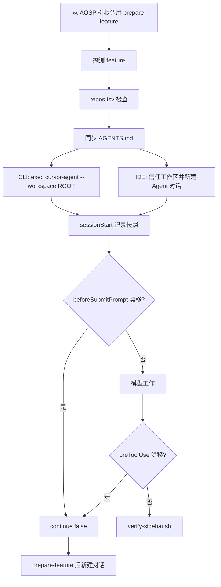

# AOSP 整机源码 Cursor Agent Harness 工程探索

> 本文讨论怎样把一棵 AOSP 整机源码树布置成 Cursor Agent 可操作、可约束、可验证的工程环境。示例目标是 AOSP 17、Cuttlefish `aosp_cf_x86_64_phone` 和 `dev-sidebar` feature；可运行代码位于仓库的 `cursor-agent/` 目录，入口见 [README](../cursor-agent/README.md)。当前仓库仅包含占位源码；离线测试验证 Harness 脚本行为，不代表 AOSP 已构建或功能已通过设备验收。本文不是把 Codex 或 Claude Code 配置改名后的说明书。

## 一、问题：为什么 Cursor Agent 在整机源码树上仍需要 Harness

Cursor Agent CLI（`cursor-agent`）会读取树根 `AGENTS.md` 和 `CLAUDE.md`，发现 `.cursor/skills` / `.agents/skills`，并可用 `.cursor/hooks.json` 观察或阻断部分事件。这些能力足够承载一份工程契约，但不会自动解决：

- AOSP 树根通常不是 Git 仓，CLI 默认用 cwd；从 `frameworks/base` 启动会看不到树根 Harness。
- 一次运行开始后，改根 `AGENTS.md` 软链不等于当前会话已重载指令。
- 嵌套 `.cursor/skills/` 会被扫描，且限定到该子树。把物理源命名成 `features/.cursor` 会造成双注册或错误 scope。
- PATH 上的 `agent` 可能是其他产品。本适配机上 `agent` 是 Grok CLI。

Harness 用 wrapper 在启动前选对 feature，用独立适配器暴露 Cursor 标准入口，用脚本验证器给出 `RESULT PASS`。

## 二、官方能力边界

| 能力面 | 文档化行为 | Demo 选择 | 真实 AOSP 建议 |
| --- | --- | --- | --- |
| 根指令 | CLI 读取树根 `AGENTS.md` 和 `CLAUDE.md`，并叠加 `.cursor/rules` | 只用根 `AGENTS.md` 软链作为 feature 入口 | 审计嵌套 `AGENTS.md`，避免仓内旧约定覆盖硬约束 |
| 工作区 | `--workspace` 指定目录；默认 cwd | wrapper `cd` 到树根并传入 `--workspace` | 始终从树根经 wrapper 启动 |
| worktree | `-w` / `--worktree` 在 `~/.cursor/worktrees/` 复制 Git checkout | wrapper 拒绝该参数 | 不要对整机树使用 worktree |
| skills | `.cursor/skills`、`.agents/skills`，兼容 `.claude/skills` / `.codex/skills`；支持 `paths` 与 `description` | 只暴露 `.cursor/skills`；显式 `/skill-name` 路由；不使用 `paths` | 不要依赖路径自动激活；同树 Codex `.agents/skills` 可能双注册 |
| hooks | `.cursor/hooks.json` version 1；`sessionStart` 不能阻断；`beforeSubmitPrompt` 可 `continue: false`；`preToolUse` 可 `permission: deny` | 离线验证脚本协议；CLI 实触发记为缺项 | 用本机版本做一次最小集成后再声称已拦截 |
| trust | `--trust` 可跳过工作区提示 | 日常入口不自动 `--trust` | 按团队策略审查项目 hook |

`sessionStart` 是 fire-and-forget。SessionStart 不会追溯性地替换本次运行的 AGENTS.md。

## 三、方案总览：Cursor 原生三层 Harness

```text
cursor-agent/
├── AGENTS.md -> features/dev-sidebar/AGENTS.md
├── .cursor -> features/.harness/cursor
└── features/.harness/cursor/{bin,hooks.json,hooks,skills}
```

物理目录必须叫 `cursor` 而不是 `.cursor`。安装器只创建 `.cursor -> features/.harness/cursor`。

| 层 | 职责 | 落点 |
| --- | --- | --- |
| ① 上下文 | 启动前选对 feature，会话中漂移则停 | `cursor-feature`、`AGENTS.md`、hooks |
| ② 流程 | 构建与部署步骤可检查 | `.cursor/skills`、`check-process-layer` |
| ③ 验证 | 只有 `RESULT PASS` 才算完成 | `verify-sidebar.sh` |

## 四、第①层 上下文：启动前选对 AGENTS.md

`.cursor/bin/prepare-feature` 先查看锚点仓 `frameworks/base`、`frameworks/native`、`frameworks/av`、`system/core`。按顺序采用首个合法 Git 仓的 symbolic branch；名称非法则拒绝，不继续找下一仓。没有候选分支时才读取 `CURRENT_FEATURE`。feature 名必须是单行 ASCII 单组件。它不启动客户端。CLI 的 `cursor-feature` 共用这一步，再解析 `cursor-agent`。

真实 repo 树（存在 `.repo` 目录）会在切换链接前运行 `check-branch.sh`。缺仓、DRIFT、DETACHED、INVALID 都会 fail closed，且不改旧 `AGENTS.md` 软链。普通根 `AGENTS.md` 文件拒绝覆盖。

解析客户端时优先 `cursor-agent`。只有 `agent --help` 含 `Start the Cursor Agent` 才回退。调用方未指定时追加 `--workspace "$ROOT"`；出现 `--worktree` 或 `-w` 则拒绝启动。

子目录 `AGENTS.md` 会在编辑该子树时叠加。feature 约定必须放在树根当前软链指向的文件；不要把硬约束只写进 `features/<feature>/`。

漂移 hook 按 `session_id` 或 `conversation_id` 隔离快照，默认状态目录为 `${TMPDIR:-/tmp}/aosp-cursor-harness-$UID`。`sessionStart` 只在快照缺失时建立基线，已有快照不会被改写。提示提交时比较 feature token，不重读 `repos.tsv`，不能发现非锚点仓的分支漂移。构建交接或完成前重新运行 `./features/dev-sidebar/check-branch.sh`。恢复方式是在树根运行 `prepare-feature` 后新建 IDE Agent 对话；CLI 再经 `cursor-feature` 启动。切换 feature 后不要恢复旧对话。项目 hooks 需要信任工作区，日常入口不要用 `--trust` 绕过。



## 五、第②层 流程：用 `.cursor/skills` 渐进披露

本 demo 只有两个 repository skills。显式选择 `/build-services-jar` 或 `/build-sepolicy`。File paths alone do not select skills. 没有把 `paths` 写成自动触发机制。

构建必须在 bash 中 `source build/envsetup.sh`，使用 lunch 目标 `aosp_cf_x86_64_phone-trunk_staging-userdebug`，在同一个 exec session 里后台构建、轮询、`wait`、检查 `#### build completed successfully` 和产物。`m services` 与 `m selinux_policy` 各自保留唯一 `mktemp` 日志。需要全镜像时同样重新初始化环境后执行 `m`。

设备命令固定 `ANDROID_SERIAL`，先 `get-state`。Cuttlefish 先 `cvd fleet`，再使用 `CVD_GROUP` 与 `cvd --group_name`。SELinux 使用 `system_server_service` 属性方案，而不是原始 `allow system_server sidebar_service:service_manager { add find };`。

`.cursor/bin/check-process-layer` 不运行 AOSP 构建，只静态检查这些协议仍在 skill 文件中。

## 六、第③层 验证闭环：只有 RESULT PASS 才算完成

[verify-sidebar.sh](../cursor-agent/features/dev-sidebar/verify-sidebar.sh) 把基础验收编码为五项断言：`sys.boot_completed`、`pidof system_server`、crash buffer、`service list`、`pm list packages`。查询失败即 FAIL。crash 默认从 `btime` 起算，也可用 `--since`；logcat 使用 `epoch,nsec`。

- `RESULT PASS`：退出 0
- `RESULT FAIL`：非零
- `RESULT INCOMPLETE`：有 SKIP 无 FAIL，默认非零
- `--allow-skip` 仅用于探索，不得作为交付证据

## 七、从 Codex / Claude Code 迁移时不能直接照搬什么

| 维度 | 不要做的事 | 正确动作 |
| --- | --- | --- |
| 入口 | 把 `.codex` 改名为 `.cursor`，或把 Claude `settings.json` 事件名改成 Cursor 的 | 独立适配器，共享 `repos.tsv` / `check-branch.sh` / `verify-*.sh` |
| 指令文件 | 为 Cursor 只准备 `CLAUDE.md` 当唯一入口 | 用树根 `AGENTS.md` |
| skills | 把 skill 只放在 `features/` 子树里指望自动加载 | 经树根 `.cursor/skills` 暴露 |
| hooks | 复用 Codex `continue/stopReason/systemMessage` 或 Claude 纯告警 | 按 Cursor 字段返回 `continue` 或 `permission` |
| CLI | `exec agent` 而不鉴别产品 | 优先 `cursor-agent` |
| 部署 | 把直接 push 当生产入口 | 真机事务见部署参考 |

不要为 Cursor Agent 创建 Codex 的 `.codex/hooks.json` 作为唯一 hook 配置。不要把 Claude `paths` 复制成“改了某路径就一定会激活”。任务卡是稳定接口，不要求预建索引。导航使用 `rg` + live source。

## 八、工程化加固与测试

[test-harness.sh](../cursor-agent/tests/test-harness.sh) 覆盖安装冲突、wrapper `--dry-run`、非法 feature、分支检查、模拟 `cursor-agent` 启动参数、hook 脚本协议、流程工件和 verifier。`run-demo.sh` 含故意失败展示；评估时读取场景预期。仓库级 `bash scripts/check.sh --offline` 验证原始示例和仓库协议。

证据先于完成声明。Hook stdin 测试不能冒充客户端已加载。O_NOFOLLOW 状态目录、路径穿越和 NUL feature 名都要拒绝。

## 九、边界与下一步

- CLI hook 实触发未在本 demo 中用真实 `cursor-agent` 验证。桌面 IDE 的事件投递、信任工作区后的阻断和 skills 发现同样未在真实对话中验收；`tests/test-cursor-app.sh` 只覆盖离线准备与 hook 协议。
- Cloud Agent 不运行 `sessionStart`，不能用这份快照基线。
- 提示提交 hook 只比较 active feature token，不会持续重跑 `repos.tsv`。
- 默认状态目录按 UID 共用，未加入树根标识。
- 直接 push 示例没有不可变备份或整组回滚。
- 安装器会替换任何已有软链？不会；冲突拒绝覆盖，没有 ownership marker。

下一步是在目标 AOSP 树上按 `build-aosp-harness` 选择 Cursor 客户端，用本机 CLI 版本补一份最小 hook 集成证据。

### intent 协作与分层验收

当前示例按 [协作约定](../skills/build-aosp-harness/references/intent-cooperation.md) 在 feature 内使用 `.intent/` 存放新规划，保留已有文档原位。小需求依据事先约定的自身验收与必要回归交付，独立审查仅在用户要求或项目规则要求时成为完成条件；整个 feature 仍需全部需求和严格验证最终 `RESULT PASS`、退出 0。本文的整体 PASS 要求用于 feature 交付，不作为澄清、规划或其他独立小需求的完成条件。

`--demo --allow-skip` 有跳过时输出 `RESULT INCOMPLETE`、退出 0；严格模式仍非零，失败优先于跳过。离线演示不证明真实客户端调用、Android 编译或设备行为。规划不自动启动构建，读取 build skill 不自动授权部署；worker 使用明确仓路径范围，共享构建目录和设备串行安排。
