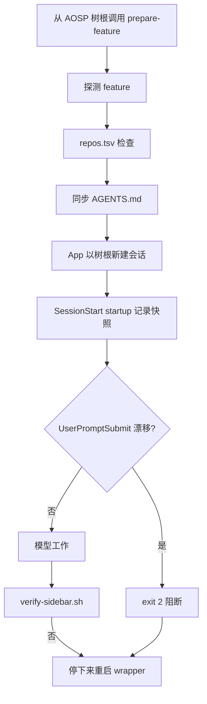

# AOSP 整机源码 ZCode Harness 工程探索

> 本文讨论怎样把一棵 AOSP 整机源码树布置成 ZCode 可操作、可约束、可验证的工程环境。示例目标是 AOSP 17、Cuttlefish `aosp_cf_x86_64_phone` 和 `dev-sidebar` feature；可运行代码位于仓库的 `zcode/` 目录，入口见 [README](../zcode/README.md)。当前仓库仅包含占位源码；离线测试验证 Harness 脚本行为，不代表 AOSP 已构建或功能已通过设备验收。本文不是把 Codex 或 Claude Code 配置改名后的说明书。

## 一、问题：为什么 ZCode 在整机源码树上仍需要 Harness

ZCode 会读取工作区 `AGENTS.md`（从当前目录向上搜索到项目根），发现 `.zcode/skills` / `.agents/skills`，并在 `.zcode/config.json` 或用户配置中挂载 hooks。这些能力足够承载一份工程契约，但不会自动解决：

- AOSP 树根通常不是 Git 仓，从 `frameworks/base` 打开会把项目根定位到子仓，看不到树根 Harness。
- 一次会话开始后，改根 `AGENTS.md` 软链不等于当前会话已重载指令。
- 配置文件 hooks 默认禁用，忘记 `"hooks": {"enabled": true}` 时所有 hook 静默不运行。
- user scope（`~/.zcode/skills`、`~/.agents/skills`）同名 skill 优先于工作区版本，可能遮蔽树内流程 skill。

Harness 用 wrapper 在启动前选对 feature，用独立适配器暴露 ZCode 标准入口，用脚本验证器给出 `RESULT PASS`。

## 二、官方能力边界

以下“文档化行为”指 ZCode 内置 `zcode-guide` 插件随客户端发布的配置指南；“Demo 选择”是本仓库 `zcode/` 的取舍。

| 能力面 | 文档化行为 | Demo 选择 | 真实 AOSP 建议 |
| --- | --- | --- | --- |
| 指令文件 | 工作区 `<repo>/AGENTS.md`，从 cwd 向上搜索到项目根；用户 `~/.zcode/AGENTS.md` 先加载，工作区后加载可收窄 | 只用树根 `AGENTS.md` 软链作为 feature 入口 | 审计用户级默认指令，避免宽泛默认覆盖树级硬约束 |
| 工作区 | 项目根由 AGENTS.md/配置发现决定 | wrapper `cd` 到树根再启动 | 始终从树根经 wrapper 启动 |
| skills | `.zcode/skills` 与 `.agents/skills`，同层 `.zcode` 优先；user scope 同名优先；SKILL.md 用 name/description | 只暴露 `.zcode/skills`；显式 `/skill-name` 路由；不使用 `paths` | 不要依赖路径自动激活；家目录同名 skill 会遮蔽树内版本 |
| hooks | 配置在 `.zcode/config.json` 的 `hooks.events`，**默认禁用需 `enabled: true`**；恰好七个事件，无 SessionEnd；matcher 为大小写敏感正则，SessionStart 匹配 `startup/resume/clear/compact` | `SessionStart`（带 matcher）与 `UserPromptSubmit` 统一进入 `session-lifecycle.sh` | 修改 hooks 后确认 enabled 仍为 true，并在 ZCode 日志核对执行记录 |
| 阻断协议 | 命令 hook 退出码 0 通过、2 阻断、其他非零报错；stdout 走严格 JSON schema，多余 key 判失败 | hook 一律 stdout 留空，阻断原因写 stderr，exit 2 | 不要复用 Codex 的 `continue/stopReason` JSON，也不要往 stdout 打印人读文本 |
| 模板变量 | `${ZCODE_PROJECT_DIR}` / `${CLAUDE_PROJECT_DIR}`、`${CLAUDE_SESSION_ID}` 会展开并注入环境 | hook 命令用 `bash \"${ZCODE_PROJECT_DIR}/.zcode/hooks/...\"` | 不依赖调用者 cwd |

`SessionStart` 不会追溯性地替换本次会话的 AGENTS.md。ZCode 没有 SessionEnd 事件，快照不自动清理。

## 三、方案总览：ZCode 原生三层 Harness

```text
zcode/
├── AGENTS.md -> features/dev-sidebar/AGENTS.md
├── .zcode -> features/.harness/zcode
└── features/.harness/zcode/{bin,config.json,hooks,skills}
```

物理目录必须叫 `zcode` 而不是 `.zcode`。安装器只创建 `.zcode -> features/.harness/zcode` 一个相对软链，冲突拒绝覆盖，没有 ownership marker。

| 层 | 职责 | 落点 |
| --- | --- | --- |
| ① 上下文 | 会话开始前选对 feature，会话中漂移则停 | `prepare-feature`、`AGENTS.md`、hooks |
| ② 流程 | 构建与部署步骤可检查 | `.zcode/skills`、`check-process-layer` |
| ③ 验证 | 只有 `RESULT PASS` 才算完成 | `verify-sidebar.sh` |

## 四、第①层 上下文：启动前选对 AGENTS.md

`.zcode/bin/prepare-feature` 先查看锚点仓 `frameworks/base`、`frameworks/native`、`frameworks/av`、`system/core`。按顺序采用首个合法 Git 仓的 symbolic branch；名称非法则拒绝，不继续找下一仓。没有候选分支时才读取 `CURRENT_FEATURE`。feature 名必须是单行 ASCII 单组件。

真实 repo 树（存在 `.repo` 目录）会在切换链接前运行 `check-branch.sh`。缺仓、DRIFT、DETACHED、INVALID 都会 fail closed，且不改旧 `AGENTS.md` 软链。普通根 `AGENTS.md` 文件拒绝覆盖。

ZCode 官方形态是桌面 App（ADE），没有公开 CLI；本示例不做 CLI 支持，唯一入口是 `./.zcode/bin/prepare-feature`：准备上下文后在 App 中以树根为工作区新建会话；切换 feature 后不要恢复旧会话。

漂移 hook 按 `session_id` 隔离快照，默认状态目录为 `${TMPDIR:-/tmp}/aosp-zcode-harness-$UID`。提示提交时比较 feature token，不重读 `repos.tsv`，不能发现非锚点仓的分支漂移。构建交接或完成前重新运行 `./features/dev-sidebar/check-branch.sh`。恢复方式是重新经过 wrapper 启动。



## 五、第②层 流程：用 `.zcode/skills` 暴露

本 demo 只有两个 repository skills。显式选择 `/build-services-jar` 或 `/build-sepolicy`。File paths alone do not select skills. 没有把 `paths` 写成自动触发机制。

构建必须在 bash 中 `source build/envsetup.sh`，使用 lunch 目标 `aosp_cf_x86_64_phone-trunk_staging-userdebug`，在同一个 exec session 里后台构建、轮询、`wait`、检查 `#### build completed successfully` 和产物。`m services` 与 `m selinux_policy` 各自保留唯一 `mktemp` 日志。需要全镜像时同样重新初始化环境后执行 `m`。

设备命令固定 `ANDROID_SERIAL`，先 `get-state`。Cuttlefish 先 `cvd fleet`，再使用 `CVD_GROUP` 与 `cvd --group_name`。SELinux 使用 `system_server_service` 属性方案，而不是原始 `allow system_server sidebar_service:service_manager { add find };`。

`.zcode/bin/check-process-layer` 不运行 AOSP 构建，只静态检查这些协议仍在 skill 文件中。

## 六、第③层 验证闭环：只有 RESULT PASS 才算完成

[verify-sidebar.sh](../zcode/features/dev-sidebar/verify-sidebar.sh) 把基础验收编码为五项断言：`sys.boot_completed`、`pidof system_server`、crash buffer、`service list`、`pm list packages`。查询失败即 FAIL。crash 默认从 `btime` 起算，也可用 `--since`；logcat 使用 `epoch,nsec`。离线演示入口是 `verify-sidebar.sh --demo`，用确定性数据源驱动同一套断言。

- `RESULT PASS`：退出 0
- `RESULT FAIL`：非零
- `RESULT INCOMPLETE`：有 SKIP 无 FAIL，默认非零
- `--allow-skip` 仅用于探索，不得作为交付证据

## 七、从 Codex / Claude Code 迁移时不能直接照搬什么

| 维度 | 不要做的事 | 正确动作 |
| --- | --- | --- |
| 入口 | 把 `.codex` 改名为 `.zcode`，或把 Claude `settings.json` 原样复制 | 独立适配器，共享 `repos.tsv` / `check-branch.sh` / `verify-*.sh` |
| 指令文件 | 为 ZCode 只准备 `CLAUDE.md` 当唯一入口 | 用树根 `AGENTS.md` |
| hooks 配置 | 复用 Codex 的 `.codex/hooks.json` 外层结构 | 写 `.zcode/config.json` 的 `hooks.events`，并显式 `enabled: true` |
| 阻断协议 | 输出 Codex `continue/stopReason/systemMessage` JSON | stdout 留空，原因写 stderr，exit 2 |
| skills | 把 skill 只放在 `features/` 子树里指望自动加载 | 经树根 `.zcode/skills` 暴露 |
| 部署 | 把直接 push 当生产入口 | 真机事务见部署参考 |

不要为 ZCode 创建 Codex 的 `.codex/hooks.json` 作为唯一 hook 配置。不要把 Claude `paths` 复制成“改了某路径就一定会激活”。任务卡是稳定接口，不要求预建索引。导航使用 `rg` + live source。子代理任务卡作为稳定输入，是工作约定，不是强制隔离机制。

## 八、工程化加固与测试

[test-harness.sh](../zcode/tests/test-harness.sh) 覆盖安装冲突、prepare 幂等与不启动客户端、非法 feature、分支检查、hook 脚本协议（exit 2 / stderr / 空 stdout）、流程工件和 verifier。`tests/test-zcode-app.sh` 离线驱动 config.json 中配置的真实命令，覆盖准备幂等、恢复基线不可改写、漂移阻断。`run-demo.sh` 含故意失败展示；评估时读取场景预期。仓库级 `bash scripts/check.sh --offline` 验证原始示例和仓库协议。

证据先于完成声明。Hook stdin 测试不能冒充客户端已加载。O_NOFOLLOW 状态目录、路径穿越和 NUL feature 名都要拒绝。编辑器可能原子替换软链本身，所以 wrapper 每次启动都重新同步，漂移判定只比较 active feature token。

## 九、边界与下一步

- 真实 ZCode 会话的 hook 事件投递与 stdin payload 字段名未在本 demo 中用真实客户端验证；离线脚本按文档化契约驱动，验收步骤见 [README](../zcode/README.md)。
- 配置文件 hooks 默认禁用；若有人手工编辑 config.json 丢失 `enabled: true`，hook 会静默不运行。
- `.zcode` 整目录被软链接管，用户自己的工作区级 MCP 等配置需写入 harness 管理的 config.json；实测 Desktop 会向工作区 `.zcode/plans/` 写计划文件，接管后经软链落入 `features/.harness/zcode/plans/`。
- 提示提交 hook 只比较 active feature token，不会持续重跑 `repos.tsv`。
- 默认状态目录按 UID 共用，未加入树根标识。
- 直接 push 示例没有不可变备份或整组回滚。

下一步是在目标 AOSP 树上按 `build-aosp-harness` 选择 ZCode 客户端，用本机 ZCode 补一份最小 hook 集成证据（ZCode 日志中的触发记录即可）。

### intent 协作与分层验收

当前示例按 [协作约定](../skills/build-aosp-harness/references/intent-cooperation.md) 在 feature 内使用 `.intent/` 存放新规划，保留已有文档原位。小需求依据事先约定的自身验收与必要回归交付，独立审查仅在用户要求或项目规则要求时成为完成条件；整个 feature 仍需全部需求和严格验证最终 `RESULT PASS`、退出 0。本文的整体 PASS 要求用于 feature 交付，不作为澄清、规划或其他独立小需求的完成条件。

`--demo --allow-skip` 有跳过时输出 `RESULT INCOMPLETE`、退出 0；严格模式仍非零，失败优先于跳过。离线演示不证明真实客户端调用、Android 编译或设备行为。规划不自动启动构建，读取 build skill 不自动授权部署；worker 使用明确仓路径范围，共享构建目录和设备串行安排。
